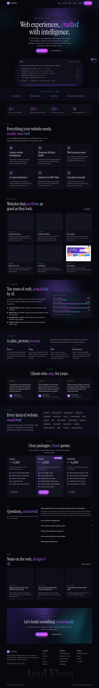
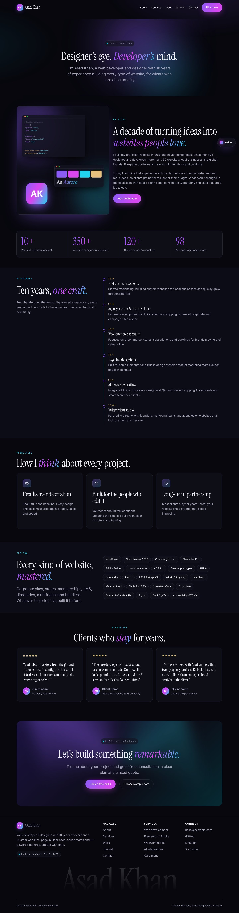
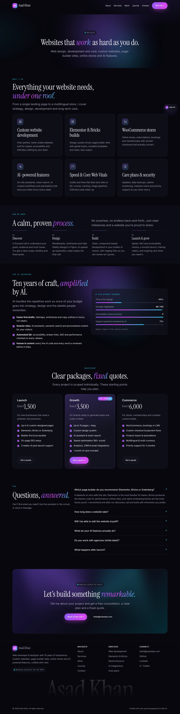
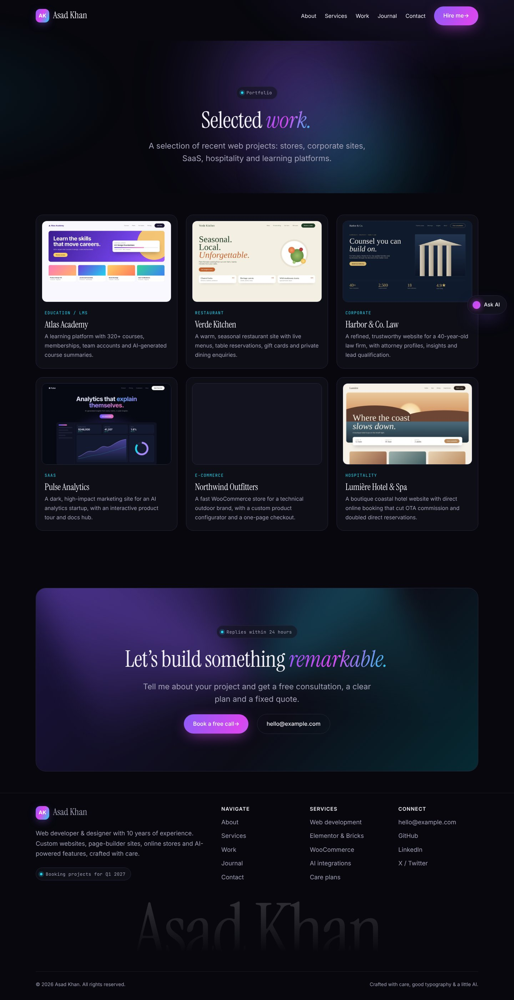
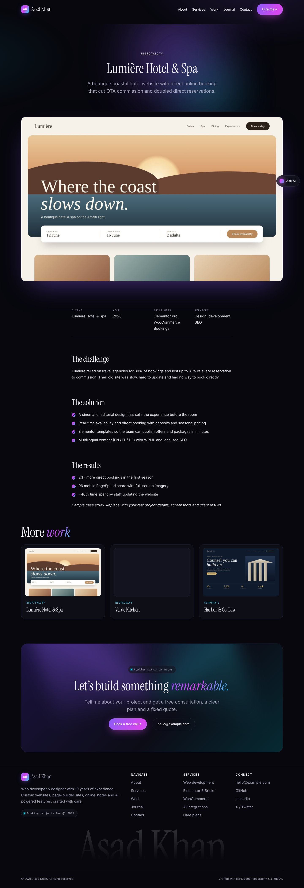
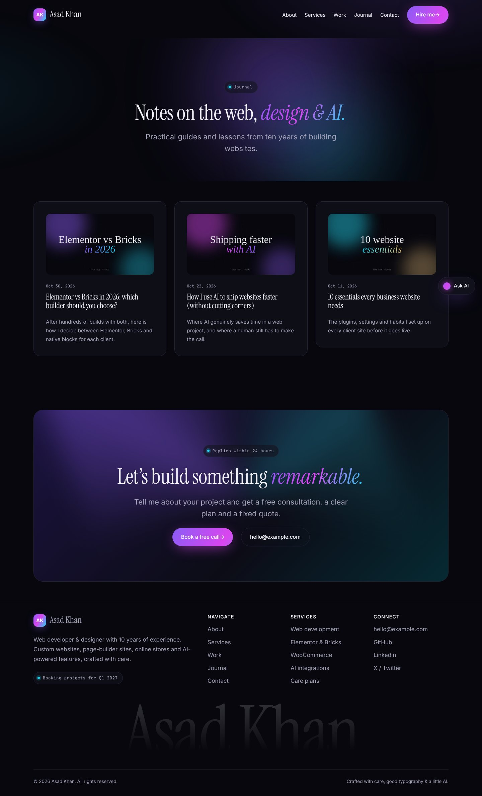
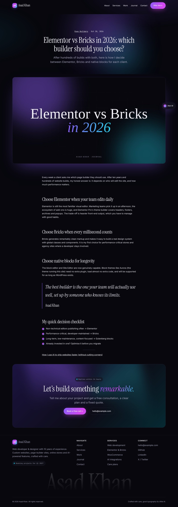
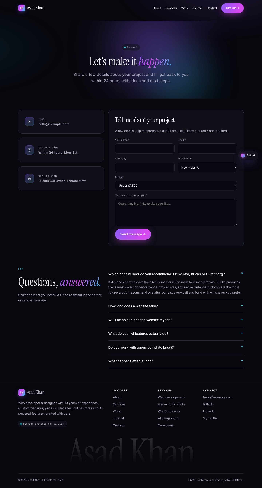
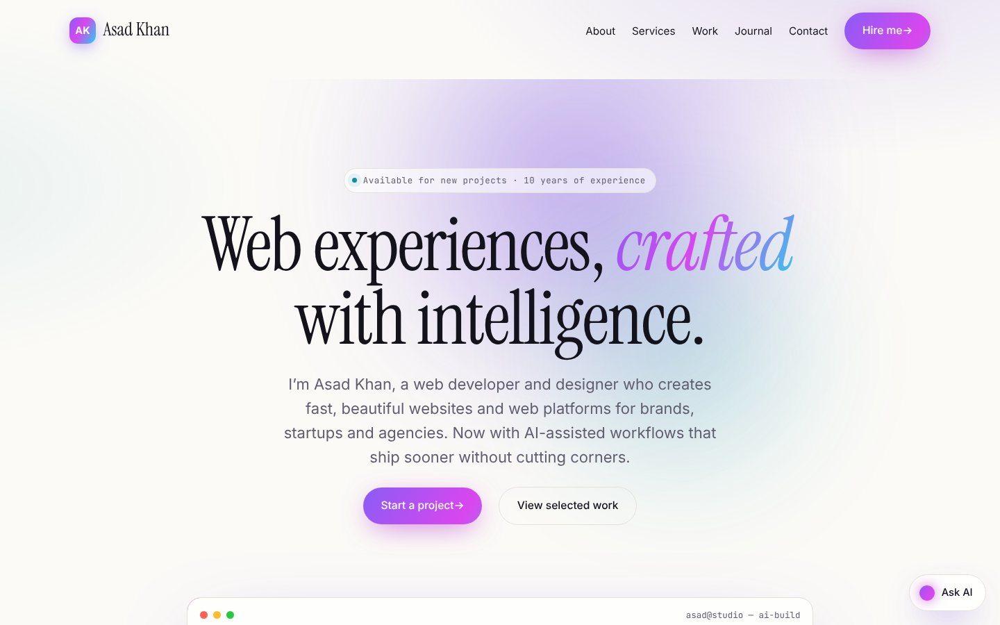
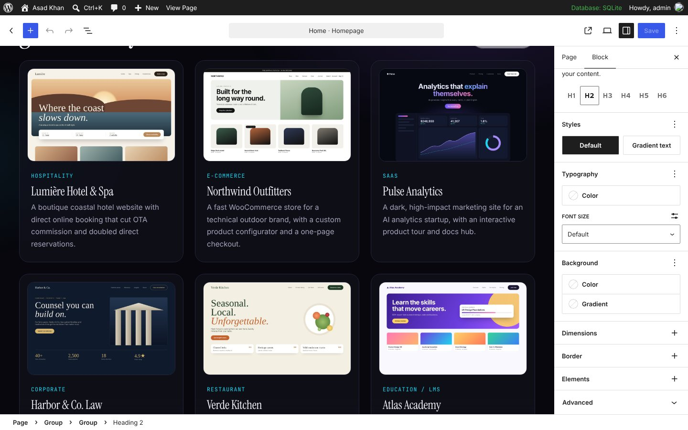

# Asad Khan: Portfolio Website (WordPress)

An elegant, dark, gradient-rich portfolio website for a web developer and designer, built on WordPress with a custom block theme (**Aurora**) and a companion plugin (**Aurora Core**). It includes AI touches: an animated "AI build" console in the hero and a floating quick-answer assistant.



## What's included

| Part | Where | What it does |
|---|---|---|
| **Aurora theme** | `wp-content/themes/aurora/` | Block theme for the Site Editor: 13 templates, 24 drag-and-drop patterns, custom block styles (Glass card, Gradient text, Glow and Ghost buttons, Browser-frame image, Check-mark list), bundled fonts, dark default plus a **Daylight** light style |
| **Aurora Core plugin** | `wp-content/plugins/aurora-core/` | Portfolio **Projects** post type and categories, spam-protected **contact form** (saves to *Enquiries* and emails you), one-click **demo content importer** |
| **Demo content** | `wp-content/plugins/aurora-core/demo/` | Home, About, Services, Contact and Journal pages, 6 portfolio case studies with screenshots, 3 blog posts, main menu, settings |
| **Complete WordPress (Docker)** | `docker-compose.yml`, `setup/install.sh` | WordPress, MariaDB, the theme, the plugin, essential plugins and the demo content in one command |
| **Upload-ready zips** | `dist/` | `aurora-theme.zip` and `aurora-core-plugin.zip` for *Appearance → Themes → Add New → Upload* and *Plugins → Add New → Upload* |

### Pages
Home · About · Services · Work (portfolio archive and case-study pages) · Journal (blog) · Contact · 404 · Search

### Home page sections
Hero with AI build console · tools marquee · animated stats · services · featured work · "AI advantage" · process · testimonials · skills · pricing · FAQ · latest posts · call to action · footer · AI assistant

## Editing: visual, no code

- **Block editor / Site Editor (built in):** every page is made of normal WordPress blocks. Click any text, image or button to edit it. Add sections from the inserter under **Patterns → Aurora: Sections**, or build a whole page from **Aurora: Full pages**. Change colours and fonts site-wide in *Appearance → Editor → Styles*.
- **Elementor:** installed by the Docker setup. Edit any page with Elementor and choose the **Blank Canvas (for Elementor)** template (no theme header or footer) or **Landing** (keeps the Aurora header and footer). Projects support Elementor too. Put the contact form anywhere with the Shortcode widget: `[aurora_contact_form]`.
- **Bricks Builder:** Bricks is a paid *theme*, so it replaces Aurora rather than working alongside it. If you prefer Bricks, install it with your licence and keep the Aurora Core plugin for projects, the contact form and the demo content.

## Option A: run the complete site locally (Docker)

Requires [Docker Desktop](https://www.docker.com/products/docker-desktop/).

```bash
git clone https://github.com/asod-cc/my-portfolio.git
```

```bash
cd my-portfolio
```

```bash
docker compose up -d
```

Wait about a minute for the `setup` container to finish (`docker compose logs -f setup`), then open:

- Site: http://localhost:8080
- Admin: http://localhost:8080/wp-admin, user `asad`, password `change-me-now`

To set your own password and port, copy `.env.example` to `.env` and edit it before the first `docker compose up`.

**Essential plugins installed and activated:** Elementor, Yoast SEO, Wordfence Security, UpdraftPlus (backups), WP Mail SMTP, Redirection, WP Super Cache, Smush, Complianz (GDPR cookies). Google Site Kit is installed but left inactive until you connect it.

## Option B: install on your hosting (no command line)

1. Install WordPress on your host (most hosts offer one-click install).
2. **Appearance → Themes → Add New → Upload Theme:** upload `dist/aurora-theme.zip` and activate it.
3. **Plugins → Add New → Upload Plugin:** upload `dist/aurora-core-plugin.zip` and activate it.
4. **Tools → Aurora Demo Content → Import demo content.** This creates all pages, projects, posts and the menu, and sets the front page.
5. Install the essentials from *Plugins → Add New* (list above) and Elementor if you want it.
6. Go to **Settings → Permalinks** and click *Save* once.

With WP-CLI on your server, `setup/install.sh` does all of this (`WP_URL=https://yourdomain.com WP_ADMIN_PASSWORD=... sh setup/install.sh`, run from the WordPress folder).

## Make it yours: replace the placeholders

These are samples. Replace them with your real details before going live:

- **Email:** `hello@example.com` in the footer, CTA and Contact patterns (search the Site Editor for it)
- **Social links:** LinkedIn and X in the footer (GitHub points to `asod-cc`)
- **Numbers:** 350+ websites, 120+ clients, 98 PageSpeed in the Stats block, and the "AI insights" figures
- **Testimonials:** the quotes are samples, so add real client feedback (*Kind words* section)
- **Projects:** the six case studies and their screenshots are fictional demos. Edit them under **Portfolio** in the dashboard
- **Prices** in the pricing section, and the **AI assistant answers** in `wp-content/themes/aurora/assets/js/theme.js` (search `answers`)
- **Site name:** *Settings → General* (the logo text "Asad Khan" / "AK" is in the Header and Footer template parts)
- **Contact form recipient:** the site admin email (*Settings → General*). Configure WP Mail SMTP so emails arrive reliably

## About the AI touches

- **Hero "AI build" console:** an animation that types example client briefs and ticks off build steps. Edit the prompts in the hero's HTML block (`data-prompts`).
- **"Ask AI" assistant:** answers common questions (pricing, timelines, builders, WooCommerce, AI, speed, care plans) instantly in the visitor's browser, from a list of keywords and answers. It needs no API key and sends no data anywhere. To make it a real AI chatbot later, connect it to an AI API through a small server-side endpoint.

## Screenshots

| | |
|---|---|
|  |  |
|  |  |
|  |  |
|  |  |
|  |  |

## Tech notes

- WordPress 6.6+ (tested on 7.1.4), PHP 8.0+
- No build step. The theme is plain CSS and JS (about 10 KB of JS), and fonts (Inter, Instrument Serif, JetBrains Mono) are bundled locally, with no Google Fonts requests
- Animations respect *reduced motion*. Layouts tested at 390 px (phone) and 1440 px (desktop) with no horizontal scrolling
- All demo pages, posts and patterns were checked in the block editor and open with no invalid blocks
